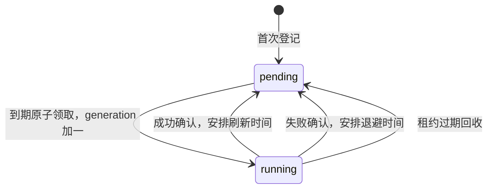

## Context

状态：2026-11-06 用户批准修订版，现按TDD实施中，未部署。需求见 [proposal.md](proposal.md)，修订依据见 [design-assessment.md](design-assessment.md)。本文件替代旧版“结果/任务同文档”设计，旧评估报告保留作为历史依据。

现有 `get_ranking_kungfu_data()` 逐人调用 `get_user_kungfu()`，默认不优先缓存；实时路径有1～3秒等待。`role_jjc_cache` 混存心法与辅助信息，其通用更新时间不证明心法时效。`role_identities` 已承载当前画像，通常原地升级且保留 `_id`；更新为字段级 `$set`。顶层 `updated_at` 参与身份 CAS 和同名候选排序，不能被心法刷新推进。

现有 `HttpClient.arequest_json()` 支持异步请求，原推栏 wrapper 是同步且内置重试；新查询复用前者和原签名构造。仓库部署展示一个 bot 容器，但文档允许多 bot/独立历史 worker，线上副本数未实测。

约束：Python 3.9；依赖方向 `plugins -> services -> infra/storage`；不覆盖身份恢复及离线统计现有未提交改动。`openspec/AGENTS.md` 当前不存在，以仓库 AGENTS、PROJECT_CONTEXT、docs/PLANS 为准。

## Goals / Non-Goals

目标：统计心法阶段批量读本地，已有结果直接复用；上榜角色后台更新；失败、重启和重复登记可恢复，旧结果不覆盖更新成功值，快照可解释。

首版固定当前3v3、一个消费者，不承诺租约失效即绝对禁止另一集合发布、不提供全局限流或热备；不增加前台等待、复杂优先级、control文档、双心跳、seed管理平台、无限画像历史或装备指标新版本。不重构完整历史同步，不用当前心法改历史快照。

## Decisions

### 1. 心法属于角色画像，队列只保存调度

| 集合 | 职责 |
|---|---|
| `role_identities` | 身份及当前画像，新增唯一权威 `jjc_kungfu` 成功结果 |
| `jjc_kungfu_refresh_queue` | 每角色当前3v3任务；周期/重试、代次、租约，不复制权威心法 |
| `role_jjc_cache` | 旧路径及已有辅助数据，不能覆盖新心法或充当新结果双写目标 |
| `jjc_ranking_stat_summaries/details` | 冻结本次采用值、覆盖率与时效 |

`role_identities` 新增子对象示例（时间为UTC Unix秒，ID为规范映射值）：

```json
{
  "jjc_kungfu": {
    "kungfu_id": "<规范ID>",
    "name": "冰心诀",
    "season_id": "<配置赛季>",
    "season_start": 1793808000,
    "pvp_type": 3,
    "algorithm_version": 1,
    "source": "match_history",
    "requested_at": 1793922995.0,
    "verified_at": 1793923000.0,
    "win_sample_count": 10,
    "publish_version": 7
  }
}
```

没有成功值时该字段缺失，不用失败结果替换为null。`requested_at` 是本轮查询尝试开始时间（包含本地请求间隔等待），`verified_at` 是判定完成时间，均不等于最近比赛时间。首版只用本轮新取的外部输入，禁止重新计算旧缓存来推进验证时间；因此不引入多种 completeness/effective_age 状态。规范心法ID从最终选择的心法映射，不沿用旧装备所带ID。保存样本数即可，不常态保存完整响应、token、比赛证据数组或无限错误历史。

仓储增加窄接口，例如 `publish_jjc_kungfu_if_newer(identity_id, expected_locator, generation, result)`，仅 `$set jjc_kungfu`。不改身份顶层 updated_at/last_seen_at/画像对局水位，不把心法加入身份全画像 CAS 字段。普通升级、ID恢复/回滚必须保留此子对象。画像归档是身份变更审计，不因刷新心法触发；其不同 projection 不保证包含全部心法历史，统计快照承担采用值历史。

替代方案：仍将结果与任务放同文档可降低提交复杂度，但角色查询依赖调度集合、归属不自然；把全部调度字段嵌入身份会扩大身份职责及索引。本版选角色属性与队列分离，接受可恢复的两步提交。

### 2. 每角色一条长期任务，两个状态

新增 `jjc_kungfu_refresh_queue`，`_id` 直接为角色 `role_identities._id` 的 BSON ObjectId。首版仅一个3v3槽位，不按赛季/算法创建多行，也不再计算SHA256。以后多竞技场类型需新设计，不提前扩展。

```json
{
  "_id": "<BSON ObjectId，实际非字符串>",
  "scope": {"season_id": "<配置赛季>", "season_start": 1793808000, "pvp_type": 3, "algorithm_version": 1},
  "status": "pending",
  "next_run_at": 1793923200.0,
  "generation": 7,
  "lease_token": null,
  "lease_expires_at": null,
  "last_seen_in_ranking_at": 1793923200.0,
  "active_until": 1794096000.0,
  "consecutive_failures": 0,
  "last_error_code": null
}
```

generation 初始0，每次领取 `$inc 1`；作用域切换撤销旧执行权时也递增，永不归零。它是角色级发布顺序，不是比赛时间或上游数据版本。队列不能TTL删除、常规删除重建或单独回滚；意外缺失但角色已有 publish_version 时，在线登记报完整性错误；停止全部旧写入实例后，人工恢复须以该版本为generation下限（见恢复限制），不能从0开始。

索引由 `src/infra/mongo.py` 幂等建立，首版只需：

| 索引 | 键与用途 |
|---|---|
| 内建 `_id_` | 角色唯一；不再建立同义业务unique索引 |
| `idx_kungfu_next_run` | `status, next_run_at, _id`；pending到期排序领取 |
| `idx_kungfu_expired_lease` | `status, lease_expires_at`；running到期回收 |

索引查询对当前scope、active_until额外过滤，单表预计为已追踪角色规模；隔离Mongo看explain及扫描量再决定扩索引，不提前添加每类过滤组合。角色心法批量读取复用身份索引及 `_id $in`，不为未知查询预建心法索引。

登记采用批量upsert，首次无结果 next_run_at=now；已有结果但缺少任务属于完整性故障，不允许在线首次建队列；已有正常任务的后续成功按 verified_at+刷新周期安排。相同scope重复登记用 `$max` 更新最近上榜时间/active_until，不重置generation、失败次数、next_run_at或租约。迟到榜单批次不倒退追踪时间。并发首次插入遇duplicate key后重试普通登记。入队不依赖已识别心法，不复用历史同步队列的found门槛。

active_until只是追踪期限，不删除任务。到期不再领取/重试；已运行任务可完成当前有界attempt，不再主动续刷。重新上榜更新active_until后，如果next_run_at已到即可继续，不重置退避。

### 3. 领取、重试和作用域切换



消费者 `find_one_and_update` 筛选 pending、next_run_at<=now、active_until>now、当前scope，按 next_run_at/_id 排序，原子写随机lease_token、lease_expires_at并递增generation，返回新文档。每次领取token唯一，日志可带进程标识，但owner不作为另一重必需协议。

确认成功/失败的条件统一为 `_id + status=running + generation=n + lease_token=t + lease_expires_at>now + scope`；未匹配只记失去执行权，不进行无条件释放/覆盖。成功回到pending，清租约/失败计数，next_run_at=实际保存结果的verified_at+刷新周期。失败只改队列，next_run_at=now+有上限退避，保留角色结果与原验证时间。退避为 `min(60*2^(failures-1),3600)` 秒，指数在达到上限后截断；不设“第六次暂停六小时”等第二套规则。

每轮消费前按索引批量回收 lease_expires_at<=now 的running，条件更新为pending、清旧token、next_run_at=now，保留generation和失败计数；下次领取再递增。没有独立idle/queued/retry_wait扫描器。批次上限100，空队列休眠2秒，时钟与等待可注入测试。

身份不存在或查询ID冲突不写结果，记可解释错误并按退避等待，不能按同名重建身份或合并。401/403/票据失效时本次任务至少延后5分钟，当前消费者也冷却5分钟并告警；429使用有界Retry-After（1秒～1小时，缺失5分钟）。仅任务延时持久化，进程级冷却不承诺跨重启保持；不引入control文档。其他队列不受本功能冷却影响。

scope切换采用停止旧消费者→更新配置并重启→启动登记/消费的部署顺序，不允许新旧赛季/算法配置长期同时作为写入者。新scope登记发现不同scope时，以旧scope/generation/token快照CAS设置新scope、pending/next_run_at=now、清租约并递增generation，保留原角色结果和追踪信息。相同scope登记不得这样重置。旧任务后续确认必定失配；旧scope结果统计端不可用。算法版本发生不兼容变更也走该流程。

### 4. 结果先发布、任务后确认：完整协议

保证边界是**至少一次处理、发布版本单调、旧结果不能覆盖更新成功值、确认失败不丢成功结果**。不宣称exactly-once，不要求两集合事务。

1. 领取返回 `(identity_id, scope S, generation n, token t)`。
2. 读取当前角色并精确验证榜单身份/定位信息，固定必要定位字段快照L（区服、请求ID及已知稳定ID，区分缺失与null），记录requested_at；不把身份updated_at当定位版本。角色已不存在或冲突则失败确认。
3. 以S执行本轮外部查询并使用共享判定。查询失败、未知映射、不可判定不发布。进入发布前再次确认本进程仍运行当前scope，若已明确失去执行权则停止；这次预检查不是跨集合原子保证。
4. 在角色集合执行一次条件更新：`_id匹配 + L的定位字段仍匹配 + (jjc_kungfu缺失 或 已有合法publish_version<n)`。写入完整新子对象、S和publish_version=n，不upsert角色，不改其他字段。已有但缺版本/版本类型错误的子对象视为不符合本协议，拒绝自动覆盖并报schema错误；旧缓存不能伪装为新子对象。
5. 第4步成功后，以第3节租约条件确认队列，安排下次时间。确认失配不会撤回已保存结果，也不能释放后来任务。

只有本新消费者可写jjc_kungfu；旧查询、完整历史同步、seed等不能绕过版本协议写它。generation在同一角色上跨scope单调，因此B(n+1)发布后A(n)迟到会失败；仅比较各scope自己的计数不成立。

**有意接受的窗口：** A租约到期、B已领取但未发布，A仍可能在预检查后迟到写入n。如果没有更大的成功版本，该结果可以保存；B成功后会覆盖为n+1。跨scope时读者只接受自身当前scope，因此旧scope写入不能冒充当前有效值。该窗口与“失租即绝对不能写角色”的强保证不同，后者需要角色侧执行租约镜像或事务，本版不引入。定位变化时L条件仍能拒绝错误角色资料。

### 5. 失败窗口与恢复结果

| 中断/异常位置 | 已持久化内容 | 恢复处理 |
|---|---|---|
| 登记结果未知 | 可能已有任务 | 按角色_id幂等重试，不重置已有状态 |
| 领取成功但调用方未收到响应 | running可能存在，但调用方无可靠n/token文档 | 本次不发外部查询、不猜领取成功；到期回收后重新领取 |
| 领取后/查询中退出 | 任务running，角色仍旧值 | 租约到期回收，下轮以更大代次重新查询 |
| 查询成功但尚未写角色 | 仅内存新值 | 不确认成功；下轮重新查询 |
| 写角色结果未知（超时/断连） | 新值可能已保存 | 先重读同_id：若publish_version==n且scope==S，视本轮已保存再确认；无法重读则保留running等恢复；不得先按失败覆盖结果 |
| 条件写未匹配 | 身份L变化或已有更大版本等 | 重读区分原因；定位变化安排重试；已有更大版本记superseded；所有队列动作仍受token守卫，无条件写均禁止 |
| 写角色成功，确认前退出 | 新心法已可读，任务仍running | 下轮可以重复查询并发布更大版本；首版不增加“推断可免查”的恢复优化 |
| 确认结果未知 | 可能pending或仍running | 可重读/重试同token条件确认；失配不覆盖。数据库仍不可用则等待恢复，不无条件重排 |
| A迟到发布/失败/释放，B已接手并成功 | B有更大结果版本及新token | A不能覆盖B结果，不能改变B队列状态 |
| Mongo整体不可用 | 不能可靠读取或写入 | 停止本轮消费并退避，不将网络成功冒充持久化成功，不启动前台兜底 |

条件写superseded时，如本任务确认仍有效，可条件释放为pending/next_run_at=now再评估；正常同一长期队列中存在更高代次通常也意味着旧token失效。不得借superseded跳过当前scope的必要刷新或误记本轮成功。

**队列丢失/备份恢复边界：** 首版不提供在线删除重建。首次登记若任务缺失但角色已有合法publish_version=m，只在所有旧消费者已停止、无未决请求的维护条件下以generation=m重建，下一次领取m+1；否则只报异常、关闭该角色自动重建。队列与角色备份应协调恢复；若队列已有generation低于角色版本，同样停用该角色并告警，不能自动归零。该条件通过部署/维护流程保证，不用新增迁移平台掩盖破坏协议的运维操作。

### 6. 统计读取与时效

启用新统计开关后：固定榜单和选择时刻cutoff→按榜单稳定ID/区服角色ID批量解析身份→批量取角色心法→登记可定位榜单角色→固定选中值并聚合/保存。按名称fallback只是候选，须精确验证已有ID；冲突unknown，不按同名合并。新增角色沿用既有安全upsert，只有新增者需要逐项处理；已有角色热路径不得逐人find。

可用结果要求合法映射、身份和scope精确一致、合法版本和时间、verified_at<=cutoff、requested_at<=verified_at，年龄以verified_at判断。首版始终真实外部查询，不将样本最近比赛时间当缓存年龄。

统一刷新周期T：年龄<=T为fresh；T<年龄<=最大年龄M为stale，仍用于统计并后台更新；年龄>M、缺失、未来时间或scope冲突为unknown。参数为初值而非用户确认的时效承诺。不按前200名区分，不做防饥饿提升。

前台不调用心法上游、不轮询队列、不等待补齐、不执行random_sleep。冷启动即使1000人未知也照常保存，保留原名次、分数和总人数并显示覆盖率。队列登记失败可保存已读有效结果，标refresh_degraded并告警；角色结果读取失败则报统计失败，不伪装全未知成功。后台在读取期间变化不改变已选内存值；不要求Mongo跨批次一致快照。

### 7. 判定口径及HTTP复用

从现有kungfu.py提取共享纯判定，固定indicator胜场最多（仅items非空的3v3 metrics），最近40条取10胜多数、平票最近出现，不足10胜回退indicator；同一心法时source沿用既有行为。只抽取基础判定，不复制第二套算法；id由最终心法规范映射。武器/队友缺失不影响基础成功。

本次不附加未经证实的“indicator缺赛季字段一律未知”规则。scope表示本次请求/缓存的适用配置，不等于已证明所有上游样本均属本赛季。开发前用脱敏响应和现有特征测试固定端点/3v3结构及既有排序；沿用现有基础判定可接受输入，不额外按缺失时间/类型字段批量排除样本。若响应明确声明与请求目标不同的赛季/类型则拒绝；未声明时保留原回退口径并在来源说明这一局限。无法确认端点基本契约或身份时不得猜测发布。需要严格本赛季样本证明时作为后续判定口径需求，不借缓存优化静默引入。

新增薄 `src/infra/tuilan_kungfu_client.py`，复用 `HttpClient(retries=0).arequest_json()`；仅把原wrapper中必要签名/headers/body构造提成共享小函数，保留旧同步wrapper超时/重试行为。不新建HTTP传输框架。每角色最多indicator+history(size=40)，不拉回放、详情、defget，不从不完整本地历史投影补判定。没有可用history时按既有规则允许有效indicator回退，错误类别保留用于告警/退避。

外层asyncio总deadline覆盖全部await，不以httpx分阶段timeout或取消to_thread冒充总取消。调用开始间隔用消费者本地monotonic时钟，不在Mongo保存next_request_at。请求结束/取消后才能处理下一角色。

### 8. 单消费者与配置

runtime随Mongo/bot启停，与QQ是否在线无关，复用现有本地任务防重复启动模式。首版固定一个串行消费者，不配leader/双心跳；任务租约覆盖有界attempt及收尾预算，不做常规heartbeat。租约在最终确认前已过期就不强行确认，按恢复表收尾。

| 配置/策略 | 计划初值 | 说明 |
|---|---|---|
| `JJC_RANKING_KUNGFU_CACHE_ENABLED` | 0 | 新统计入口开关 |
| `JJC_KUNGFU_REFRESH_ENABLED` | 0 | 只允许一个实例启用的后台开关，可独立预热 |
| `JJC_KUNGFU_REFRESH_SECONDS` | 21600 | 统一6小时刷新 |
| `JJC_KUNGFU_MAX_STALE_SECONDS` | 86400 | 最大可用年龄24小时 |
| `JJC_KUNGFU_TRACK_SECONDS` | 172800 | 最近上榜后追踪48小时 |
| 策略常量，可注入测试 | 请求10秒、角色总25秒、租约90秒、请求间隔2秒 | 角色deadline覆盖间隔和本轮查询；不把所有常量暴露配置 |

校验正值、M>=T、角色预算小于租约并留收尾余量；非法配置关闭新功能并告警。消费者异常退出必须留下日志，启动/停止幂等，退出取消请求，不误释放别人的token。

部署必须核对所有bot/独立worker，只在一个进程启用本功能。原子领取可防同角色并发领取，不能限制多个误启进程处理不同角色时的总请求速率；运行指标必须如实说明这一限制。若线上要求多实例自动热备，先补充单一协调设计与测试，不静默声称本版支持。

### 9. 快照、辅助信息与兼容

summary各范围增加 `{total,fresh,stale,unknown,coverage}`，满足total=fresh+stale+unknown，coverage=(fresh+stale)/total；空范围coverage=null，避免除零。成员最小新增 `kungfu_verified_at, kungfu_source, kungfu_freshness, kungfu_unknown_reason, kungfu_publish_version`，并保存scope/算法上下文。选择完成后仅用内存值生成快照，后台不改历史。

装备/队友从已有缓存批量读取，独立检验身份及与心法的关系，不反向覆盖jjc_kungfu。不能确认装备时保留unchecked/unknown；若旧展示无法区分，隐藏该范围的相关比例或标“资料不完整”，不输出误导0%。不引入aux_stats_version=2或重算有效装备分母。两个网页入口与实际QQ图片模板只做必要未知/覆盖提示，旧快照缺时间显示“未记录时效”。

开关关闭保留旧入口和use_cached_kungfu参数行为；显式历史tag走原流程，不登记当前活跃队列。自动与默认手动入口一致。只开后台预热时，也须从已有榜单成功获取位置登记，不依赖新统计开关；历史路径不向新属性双写。

## Risks / Trade-offs

单消费者吞吐可能不足 → 记录成功率、attempt耗时、最老到期年龄和一次完整轮转；6h周期不等于已达标，先预热观察再切流。

最后成功值可能过旧或主打口径滞后 → 明确fresh/stale/unknown及验证时间；查询更新不承诺角色刚切换就识别，仍受十胜口径影响。

两集合存在短暂结果已发布/任务仍running → 这是允许的恢复窗口，读者只依赖角色结果，不以队列状态判断其可用性。

旧配置并存或队列被删除会破坏版本前提 → 单实例配置切换、停旧再启动，禁止在线重建/单独回滚；不将假设包装为分布式保障。

上游样本赛季证明不充分 → 保留原基础判定并如实记录局限，缓存scope仅限制结果复用；严格口径另立需求。

未知辅助数据增多 → 最小未知/隐藏处理，不借本次需求扩大指标改造。

## Migration Plan

1. 先完成TDD、真实隔离Mongo竞争验证与独立复核；同步当前数据库/仓储职责、配置和运行文档。当前仅在数据库文档标注待实施设计链接，不将计划描述为现有能力。
2. 部署时两开关仍关闭，确认现有未提交改动边界、新索引和部署实例清单；无线上授权不执行。
3. 仅一个实例启用后台，从当前榜单登记预热；不seed旧缓存，不伪造verified_at，不动身份/完整历史水位。旧统计继续外呼的叠加流量须纳入观察。
4. 观察至少一个完整轮转；建议切流门槛为全榜可用心法>=95%、fresh>=90%、无身份错配/版本回退。若未达标先查原因，不扩前台等待掩盖。门槛为验收初值，应记录实际数据与调整依据。
5. 开启新统计，验证冷/热均无前台心法外呼。隔离环境1000人热路径30次，心法读取/聚合P95目标<=5秒；不包含拉榜、渲染、发送，不声称整次统计硬上限。
6. 回滚先关新统计开关恢复旧流程，再关后台并等待取消/租约到期。保留角色心法、队列generation和历史快照，不删除、不归零、不单独恢复旧备份；再次启用继续原代次。

线上副本数、实际响应耗时和缓存覆盖属于上线前核验，不影响本版固定的单消费者方案。若事实不满足部署前提，停止上线并修订对应设计，不能带着未定义多实例协议直接启用。


### 可维护性整理（用户于2026-11-06确认）

角色批量解析提取“是否缺少且能补齐查询定位”和“补全后身份是否仍合法”两个私有纯函数，既有安全upsert及批量热路径不变。装备展示继续使用equipment_incomplete，不增新状态；前端以纯判断统一分布/过滤/列表/导出，提示渲染单独负责DOM写入，加载前和渲染前均检查。代次错误处理、原子Mongo类型判断和空unknown覆盖保持当前协议。

### 发布时补齐查询索引（2026-11-06）

真实生产角色库146429条，批量解析OR保留raw server/name以兼容未规范化legacy身份。该分支缺少索引会使整个OR出现COLLSCAN；本地千人库性能未体现这一规模问题。统一索引初始化补 `idx_server_name: (server:1,name:1)`，普通非unique，无TTL；不删除fallback、不拆查询或增加新匹配规则。此外 `idx_global_id` 是字符串partial索引，global_id分支复用既有 `_global_id_string_filter` 显式携带 `$eq/$type:string`，确保该分支也可选用已有索引，不新增重复global索引。真实Mongo测试必须捕获resolver实际250人OR，在完整生产索引初始化后证明winning plan无COLLSCAN；上线后用queryPlanner核对，再测只读解析/登记的实际耗时，不将此前隔离P95当生产指标。
